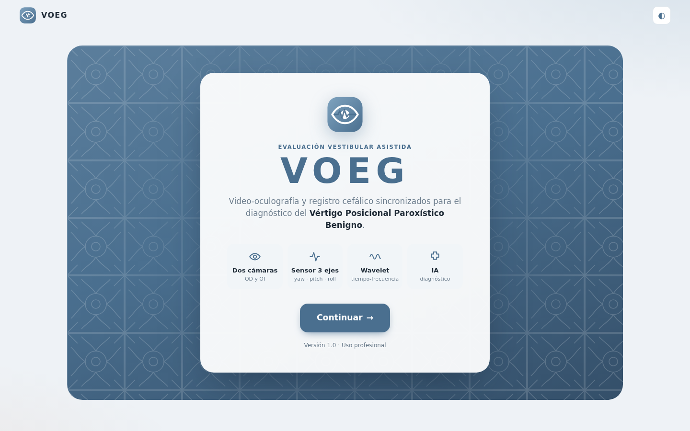
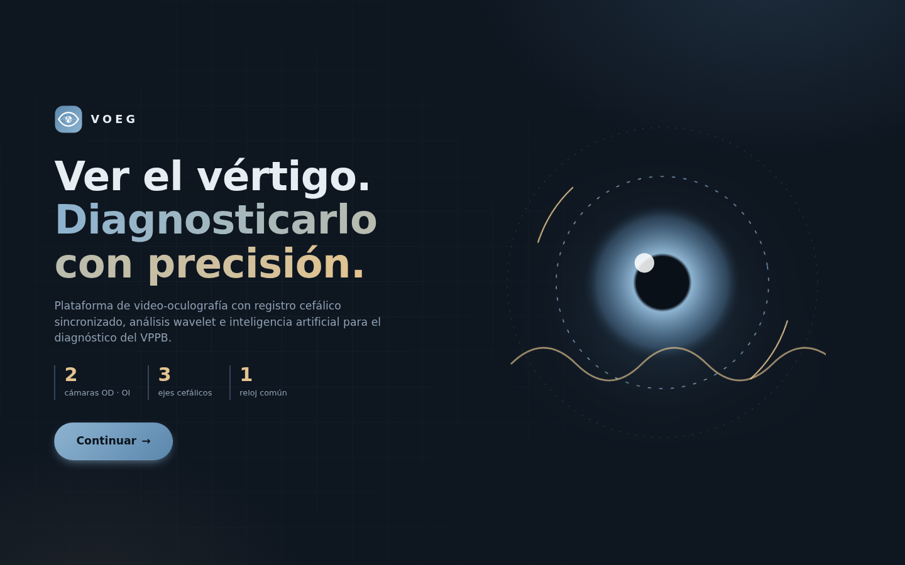
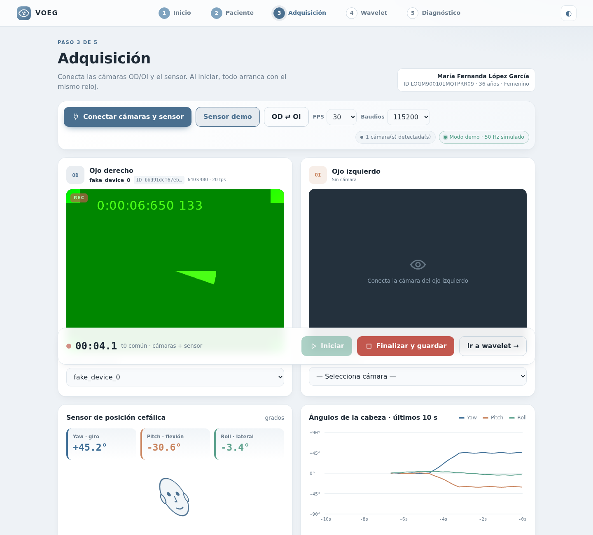
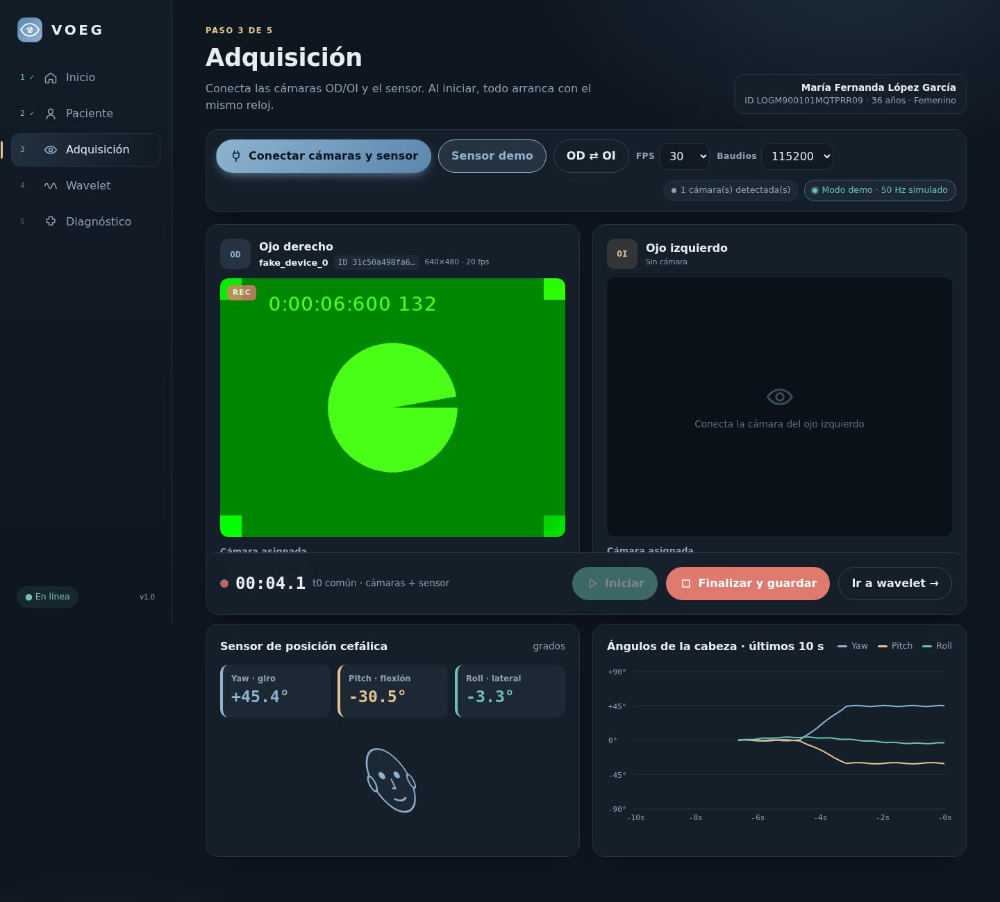

# VOEG · Diagnóstico asistido de VPPB (PWA)

Aplicación web progresiva (se instala como app en computadora, tablet o celular y funciona sin internet) para la evaluación del **Vértigo Posicional Paroxístico Benigno**:
video‑oculografía con dos cámaras, registro de ángulos cefálicos con un sensor en Arduino, análisis wavelet e inteligencia artificial.

| Opción A · Azulejo Clínico | Opción B · Noche Azulejo |
|---|---|
|  |  |
|  |  |

## Las 5 pantallas
1. **Bienvenida**: presentación de VOEG y botón *Continuar*.
2. **Paciente**: identificación, datos del examen, historia clínica, contraindicaciones y consentimiento informado. Calcula la edad y genera un ID de sesión.
3. **Adquisición**
   - *Conectar cámaras y sensor*: detecta las cámaras, muestra su **ID (deviceId)** y te deja asignar cuál es **OD** (ojo derecho) y cuál **OI** (ojo izquierdo). La asignación se recuerda. Botón OD ⇄ OI para intercambiarlas.
   - Sensor por **USB (Web Serial)**: ángulos yaw, pitch y roll en números, en una cabeza 3D y en una gráfica en vivo de 10 s. Incluye *Sensor demo* para probar sin Arduino.
   - *Iniciar*: arranca las dos grabaciones y el registro del sensor con un **mismo t0** (reloj `performance.now`, precisión sub‑milisegundo) y envía `START` al Arduino.
   - *Finalizar y guardar*: detiene todo y guarda en una carpeta que eliges:
     `…_OD.webm`, `…_OI.webm`, `…_tiempos.xlsx` y `…_sesion.json`.
   - El Excel trae las hojas **Resumen** (IDs de cámaras, fps, desfase de arranque OD vs OI en ms), **Eventos**, **Sensor** (t, t Arduino, yaw, pitch, roll) y **Cuadros_OD / Cuadros_OI** (el tiempo de cada cuadro de video), para verificar que todo quedó sincronizado.
4. **Wavelet**: manda la señal y los videos a tu código y muestra la imagen. Sin servidor calcula una CWT Morlet de demostración. También puedes subir una imagen ya hecha.
5. **Diagnóstico**: la imagen wavelet entra a tu arquitectura de IA. Se muestran el resultado, la confianza y las probabilidades por clase, y se puede imprimir un **reporte** con espacio para la firma.

## Conectar tu código
| Qué | Dónde |
|---|---|
| Sensor (Arduino) | `arduino/voeg_sensor/voeg_sensor.ino`: imprime `millis,yaw,pitch,roll` a 115200. Pega tu lectura en `leerAngulos()`. |
| Wavelet + IA en Python | `server/app.py`: reemplaza `mi_wavelet()` y `mi_diagnostico()`. Luego ejecuta `uvicorn app:app --port 8000` y escribe `http://localhost:8000` en la pantalla 4. |
| Wavelet + IA en JavaScript | `shared/plugins.js`: reemplaza las funciones `wavelet()` y `diagnostico()`. |

## Ejecutar
Las cámaras y el puerto serial solo funcionan en **https** o en **localhost**, en **Chrome o Edge** de escritorio (Web Serial no existe en Safari ni Firefox).
```bash
# desde la carpeta del repositorio
python -m http.server 8080
# abre http://localhost:8080  y elige el diseño
```
**Publicar gratis con GitHub Pages:** Settings → Pages → *Deploy from branch* → `main` / root. Quedará en `https://TU_USUARIO.github.io/voeg/` y se podrá instalar como app desde el ícono de instalar del navegador.

## Estructura
```
index.html                  selector de diseño
opcion-a-azulejo-claro/     diseño A (index.html, styles.css, manifest, sw.js)
opcion-b-noche-azulejo/     diseño B
shared/app.js               lógica común (pantallas, cámaras, serial, sincronía, Excel, wavelet demo)
shared/plugins.js           ← tu wavelet y tu IA
shared/xlsx.js              generador de Excel sin dependencias
shared/base.css             componentes comunes
server/                     puente FastAPI para tu código Python
arduino/                    sketch de ejemplo del sensor
```
Para quedarte con un solo diseño, borra la otra carpeta y haz que `index.html` redirija a la que elegiste.

## Aviso
El modo demo genera resultados **sin validez clínica**. Para comercializarlo como dispositivo médico se requiere el registro sanitario correspondiente (p. ej. COFEPRIS en México) y cumplir con la protección de datos personales de salud. `.gitignore` ya excluye videos y Excel para que no se suban datos de pacientes al repositorio.
